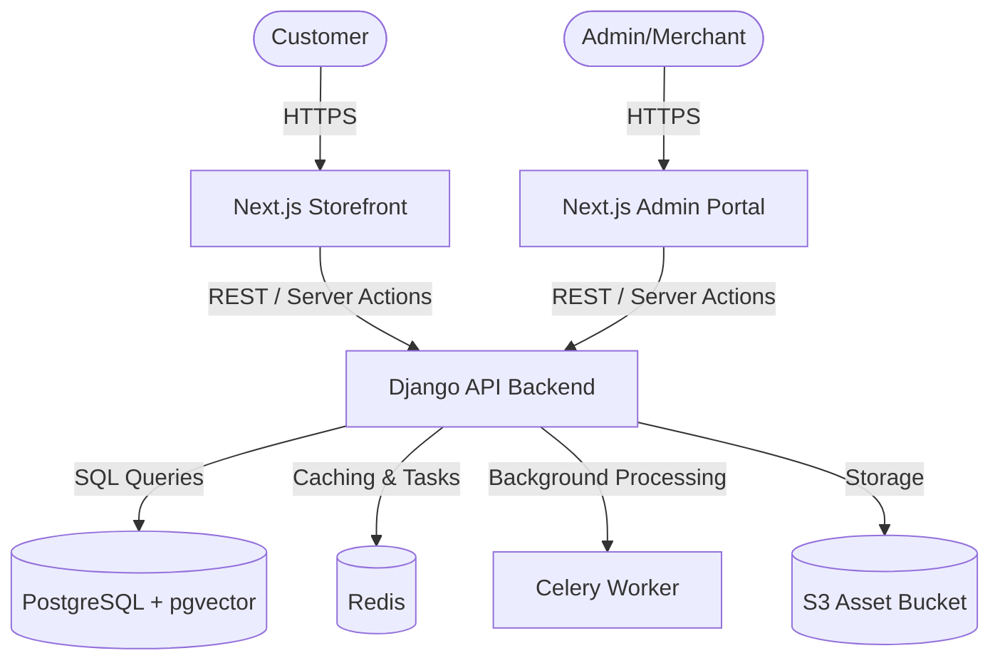

# Architecture & System Design — PerfumeBooth

## 🏗️ System Overview
The PerfumeBooth application is built on a split-system architecture consisting of a **Next.js Web Storefront**, a **Next.js Admin/Merchant Dashboard (MPS)**, and a **Django REST Framework Backend**.



---

## 📂 Folder & File Structure

### 1. Storefront (`perfumebooth/`)
Contains the user-facing e-commerce application built on Next.js 16 (App Router) and React 19.

```bash
perfumebooth/
├── src/
│   ├── app/                 # Next.js pages, layouts, and API routes
│   │   ├── (shop)/          # Main shopping pages (product lists, home)
│   │   ├── account/         # User profile, history, and address management
│   │   ├── cart/            # Dedicated cart page
│   │   ├── checkout/        # Checkout flow components & layouts
│   │   ├── globals.css      # Core Design System, colors, typography, keyframes
│   │   └── layout.tsx       # Root layout initializing fonts and overlays
│   ├── components/          # React components
│   │   ├── auth/            # Auth popups, OTP validation
│   │   ├── layout/          # Navbar, Footer, WhatsApp CTA, overlays
│   │   └── ui/              # Atom components (buttons, inputs, loaders)
│   ├── hooks/               # Custom hooks (e.g., animations, cart helpers)
│   ├── lib/                 # Core utilities and Django API adapters
│   │   ├── actions/         # Server Actions (Auth, user operations)
│   │   ├── backend/         # API wrappers mapping to Django endpoints
│   │   └── catalog.ts       # Unified catalog API exported to the storefront
│   ├── services/            # Client-side API fetch services
│   ├── store/               # Zustand global state (cart, auth, ui)
│   └── types/               # TypeScript interfaces & types
```

### 2. Backend (`perfumebooth-backend/`)
Core API engine built with Python & Django REST Framework, running background jobs via Celery and storing database files in PostgreSQL.

```bash
perfumebooth-backend/
├── apps/                    # Core django apps (products, orders, auth, cart)
├── core/                    # Global settings, routing, celery config
├── manage.py                # Django entry CLI script
├── requirements.txt         # Core Python dependency packages
└── Dockerfile               # Production & Dev container configs
```

### 3. Merchant Portal (`perfumebooth-MPS/`)
Admin dashboard built with Next.js and Tailwind CSS for merchant analytics, product listings management, and order fulfillment.

```bash
perfumebooth-MPS/
├── src/
│   ├── app/                 # Admin page router (Dashboard, Orders, Analytics)
│   ├── components/          # Reusable tables, chart wrappers, dashboard cards
│   └── store/               # Zustand store for admin state
```

---

## 💻 Technology Stack

### Storefront & MPS
*   **Framework**: Next.js 16+ (App Router, Server Actions, Server Components)
*   **UI Library**: React 19
*   **Styling**: Tailwind CSS v4, Vanilla CSS variables
*   **Animations**: Framer Motion & GSAP (GreenSock) for high-end micro-interactions
*   **Smooth Scrolling**: Lenis Scroll
*   **3D Elements**: Three.js, `@react-three/fiber`, `@react-three/drei`
*   **State Management**: Zustand
*   **Icons**: Lucide React, React Icons

### API Backend
*   **Core**: Python, Django 5.1, Django REST Framework
*   **Database**: PostgreSQL + `pgvector` (for scent similarity and semantic searching)
*   **Asynchronous Processing**: Celery & Redis (Task queue for processing emails, notifications, and inventory updates)
*   **Authentication**: SimpleJWT (Access/Refresh token rotation set via Server Action HTTP-only cookies)
